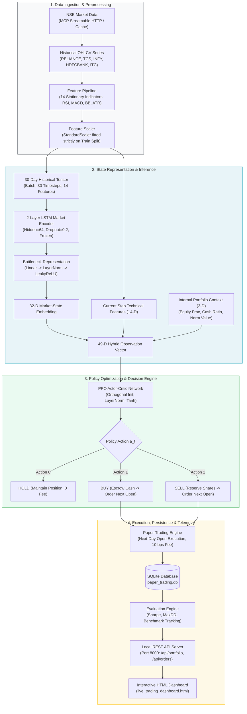
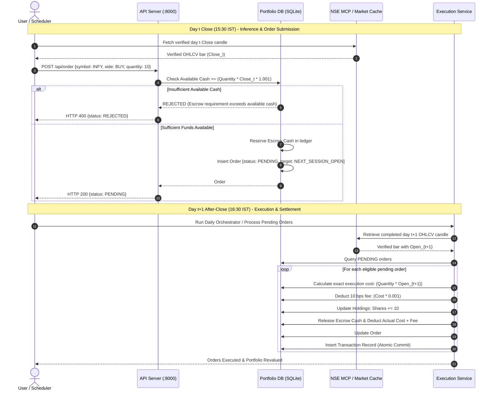

# NeuroTrader: Reinforcement Learning with RNN-Based Market State Representation for Algorithmic Trading

**Target Equities:** `RELIANCE.NS`, `TCS.NS`, `INFY.NS`, `HDFCBANK.NS`, `ITC.NS`  

> [!IMPORTANT]
> **Academic Disclaimer:** NeuroTrader is an academic algorithmic trading research system and simulated paper-trading platform developed for educational and experimental purposes. It does not connect to real financial brokerage accounts, does not deploy real financial capital, and does not provide investment advice.

---

## Table of Contents
1. [Project Title and Overview](#1-project-title-and-overview)
2. [Key Features](#2-key-features)
3. [Technology Stack](#3-technology-stack)
4. [System Architecture](#4-system-architecture)
5. [Project Directory Structure](#5-project-directory-structure)
6. [Dataset Description](#6-dataset-description)
7. [LSTM Market-State Encoder](#7-lstm-market-state-encoder)
8. [PPO Reinforcement Learning Agent](#8-ppo-reinforcement-learning-agent)
9. [Trading and Paper-Execution Workflow](#9-trading-and-paper-execution-workflow)
10. [Evaluation Methodology and Results](#10-evaluation-methodology-and-results)
    - [10.1 Supervised LSTM Encoder Evaluation](#101-supervised-lstm-encoder-evaluation)
    - [10.2 Out-of-Sample PPO Policy Evaluation](#102-out-of-sample-ppo-policy-evaluation)
    - [10.3 Phase 6 Multi-Session Forward Evaluation](#103-phase-6-multi-session-forward-evaluation)
11. [Benchmark Methodology](#11-benchmark-methodology)
12. [Live Market Data & Daily Orchestration](#12-live-market-data--daily-orchestration)
13. [Installation and Environment Setup](#13-installation-and-environment-setup)
14. [How to Run the Project](#14-how-to-run-the-project)
15. [Backend API Documentation](#15-backend-api-documentation)
16. [Backend Service Verification](#16-backend-service-verification)
17. [Configuration and Reproducibility](#17-configuration-and-reproducibility)
18. [Security and Data Integrity](#18-security-and-data-integrity)
19. [Known Limitations](#19-known-limitations)
20. [Future Research Directions](#20-future-research-directions)
21. [Troubleshooting Guide](#21-troubleshooting-guide)
22. [Academic Contribution and Conclusion](#22-academic-contribution-and-conclusion)
23. [References and Acknowledgements](#23-references-and-acknowledgements)
24. [QUICK START — RUN NEUROTRADER](#24-quick-start--run-neurotrader)

---

## 1. Project Title and Overview

### Full Project Title
**Reinforcement Learning with RNN-Based Market State Representation for Algorithmic Trading (NeuroTrader)**

### Executive Summary
NeuroTrader is an autonomous algorithmic trading framework designed to address the non-stationarity, low signal-to-noise ratio ($\text{SNR} \approx 0.028$), and partial observability of equity financial markets. The system decouples representation learning from policy optimization:
1. A **2-Layer Long Short-Term Memory (LSTM)** network acts as a temporal market-state representation extractor, compressing a 30-day lookback sequence of 14 stationary technical indicators into a continuous 32-dimensional embedding vector via a normalized bottleneck.
2. A **Proximal Policy Optimization (PPO)** Actor-Critic reinforcement learning agent consumes a 49-dimensional hybrid observation vector ($32\text{-D LSTM representation} + 14\text{-D current indicators} + 3\text{-D portfolio state}$) to select discrete portfolio actions ($\text{HOLD}, \text{BUY}, \text{SELL}$).
3. An **Execution Engine** simulates realistic trading frictions, enforcing next-eligible-session Open execution ($P_{\text{exec}} = \text{Open}_{t+1}$), a 10 basis point ($0.10\%$) transaction fee, isolated escrow cash reservation, and atomic SQLite persistence.

### Problem Statement & Motivation
Directly applying model-free reinforcement learning to raw financial price series frequently leads to catastrophic policy collapse, trade churn, and severe overfitting. Financial time series exhibit extreme noise, structural regime shifts, and non-stationary statistical distributions. By training an intermediate recurrent encoder to synthesize multi-timestep temporal dynamics into stationary latent states, the downstream RL agent receives smooth, feature-rich representations that isolate systemic market trends from localized high-frequency noise.

### Project Scope
- Target Universe: 5 benchmark National Stock Exchange of India (NSE) equities (`RELIANCE`, `TCS`, `INFY`, `HDFCBANK`, `ITC`).
- Modeling Pipeline: Supervised pre-training of the recurrent encoder followed by policy gradient optimization of the PPO agent in a custom Gymnasium environment.
- Operational Pipeline: End-to-end automated daily ingestion, inference, local REST API serving, and HTML dashboard telemetry.

---

## 2. Key Features

- **Decoupled Two-Stage Architecture:** Separates temporal state representation from trading decision logic to stabilize RL policy optimization.
- **14 Stationary Technical Indicators:** Features engineered strictly with causal rolling windows (RSI, MACD, Bollinger Bands, ATR, Log Returns, Moving Average Ratios, Volatility).
- **32-D Latent State Bottleneck:** Linear projection with Layer Normalization and LeakyReLU activation, guaranteeing bounded numerical representation.
- **Gymnasium-Compliant Trading Environment:** Custom long-only trading environment (`MarketTradingEnv`) featuring realistic portfolio accounting, discrete order management, and cash escrow.
- **Friction-Aware Next-Session Execution:** Strict $t+1$ Open execution model eliminating lookahead bias, coupled with a 10 bps ($0.10\%$) brokerage transaction cost.
- **Official NSE Market Ingestion:** Live data integration using streamable HTTP Model Context Protocol (MCP) clients with local cache fallback and 180-second TTL.
- **Deterministic Reproducibility:** Global master seed control (Seed 42) guaranteeing $100.00\%$ bitwise action matching across independent evaluation runs.
- **Local HTTP REST API:** Standalone zero-dependency Python API server providing portfolio metrics, order placement, order cancellation, and forward evaluation endpoints.
- **Interactive Telemetry Dashboard:** Standalone single-page HTML/CSS/JS dashboard rendering equity curves, drawdowns, benchmark comparisons, and live order books.
- **Automated Daily Scheduler:** Windows Task Scheduler integration (`daily_orchestrator.py`) supporting market holiday calendars, mutual-exclusion locking, and retry policies.

---

## 3. Technology Stack

The project is built on modern, validated open-source libraries:

| Layer | Component | Version / Specification | Purpose in Codebase |
| :--- | :--- | :--- | :--- |
| **Language** | Python | 3.12 / 3.13 | Core programming language |
| **Deep Learning** | PyTorch (`torch`) | $\ge 2.2.0$ | LSTM encoder & PPO Actor-Critic neural networks |
| **Environment** | Gymnasium | $\ge 1.0.0$ | Standardized RL environment interface (`MarketTradingEnv`) |
| **Data Processing** | Pandas / NumPy | $\ge 2.2.0$ / $\ge 1.26.0$ | Time series manipulation, rolling indicators, tensor ops |
| **Feature Scaling** | Scikit-Learn / Joblib | $\ge 1.4.0$ / $\ge 1.3.0$ | `StandardScaler` / `RobustScaler` fit strictly on train split |
| **Statistical Analysis**| SciPy | $\ge 1.12.0$ | McNemar test, binomial distribution, statistical metrics |
| **Database** | SQLite 3 | Built-in (`sqlite3`) | Atomic transaction ledger, escrow tables, order management |
| **API Server** | Python HTTP Server | Built-in (`http.server`) | Lightweight zero-dependency REST API server (`api_server.py`) |
| **Market Ingestion** | Model Context Protocol | Streamable HTTP Client | Official NSE live quote & historical OHLCV data retrieval |
| **Visualization** | Matplotlib | $\ge 3.8.0$ | Equity curve, loss trajectory, and diagnostic chart generation |
| **Scheduler** | Windows Task Scheduler| PowerShell 5.1 / 7+ | Automated daily market orchestrator @ 16:30 IST |

---

## 4. System Architecture

The end-to-end dataflow and model execution pipeline is structured as follows:



---

## 5. Project Directory Structure

```
NeuroTrade/
├── README.md                                 # Canonical single comprehensive project report
├── requirements.txt                          # Production dependency manifest
│
├── backend/                                  # Core algorithms, models, and runtime services
│   ├── agents/
│   │   ├── __init__.py
│   │   └── ppo_agent.py                      # ActorCriticTradingNetwork, PPOAgent, set_seed()
│   ├── environments/
│   │   ├── __init__.py
│   │   └── trading_env.py                    # Gymnasium-compliant MarketTradingEnv
│   ├── models/
│   │   ├── __init__.py
│   │   └── rnn_encoder.py                    # MarketStateLSTMEncoder architecture definition
│   ├── checkpoints/                          # Validated model checkpoints
│   │   ├── improved_rnn_encoder.pt           # Canonical 30-day LSTM encoder (55.53% accuracy)
│   │   ├── improved_rnn_encoder_v2.pt        # Audited 15-day LSTM research candidate (55.75% accuracy)
│   │   ├── ppo_reproducible_best.pt          # Canonical PPO policy network (Iteration 4)
│   │   ├── ppo_reproducible_run1.pt          # Dual-run verification run 1
│   │   ├── ppo_reproducible_run2.pt          # Dual-run verification run 2
│   │   ├── ppo_best_agent.pt                 # Historical training artifact
│   │   ├── ppo_trading_agent.pt              # Historical checkpoint
│   │   ├── best_rnn_encoder.pt               # Original baseline LSTM (Huber loss)
│   │   ├── bce_directional_encoder.pt        # BCE classification experiment checkpoint
│   │   └── focal_directional_encoder.pt      # Focal loss classification experiment checkpoint
│   ├── embeddings/                           # Extracted continuous latent representation tensors
│   │   ├── train_embeddings_improved.pt      # Pre-extracted training embeddings (4000x32)
│   │   ├── val_embeddings_improved.pt        # Pre-extracted validation embeddings (885x32)
│   │   ├── test_embeddings_improved.pt       # Pre-extracted test embeddings (895x32)
│   │   └── metadata_*.csv                    # Split date and alignment metadata
│   ├── live_data/                            # Operational paper-trading & evaluation backend
│   │   ├── api_server.py                     # Local REST API server (port 8000)
│   │   ├── daily_orchestrator.py             # Scheduled market ingestion & execution orchestrator
│   │   ├── dashboard.py                      # Console & HTML telemetry report generator
│   │   ├── data_fetcher.py                   # Market data acquisition & validation pipeline
│   │   ├── evaluation_engine.py              # Multi-session performance & benchmark analytics
│   │   ├── feature_pipeline.py               # Live 14-indicator feature engineering
│   │   ├── inference_engine.py               # Live LSTM + PPO inference pipeline
│   │   ├── market_cache.py                   # Local cache with 180s TTL and stale-data protection
│   │   ├── nse_mcp_client.py                 # Streamable HTTP MCP client for official NSE data
│   │   ├── nse_mcp_retry.py                  # Exponential backoff & retry wrapper
│   │   ├── paper_trader.py                   # Order lifecycle & console portfolio summary
│   │   ├── portfolio_db.py                   # SQLite schema, atomic transactions, escrow logic
│   │   ├── run_live.py                       # CLI driver for end-to-end live inference
│   │   ├── scheduler_config.py               # Market trading hours & NSE holiday calendar
│   │   ├── test_paper_trading.py             # Unit tests: Escrow, cash balance, order bounds
│   │   ├── test_phase36_integration.py       # Integration tests: REST API, CORS, lifecycle
│   │   ├── test_phase37_execution.py         # Execution tests: Next-Day Open execution, single-execution
│   │   ├── test_phase5_scheduler.py          # Scheduler tests: Calendar, mutex locking, idempotency
│   │   ├── test_phase6_evaluation.py         # Evaluation tests: Benchmark tracking, Sharpe safety
│   │   ├── test_pipeline.py                  # Pipeline tests: Feature calculation, tensor sizing
│   │   ├── validate_phase4.py                # Comprehensive Phase 4 verification suite
│   │   ├── audit_comprehensive_suite.py      # System integration test suite
│   │   └── audit_phase35_reliability.py      # Reliability test suite
│   ├── notebooks/                            # Development, modeling & training notebooks
│   │   ├── 01_lstm_training.ipynb            # Supervised LSTM encoder training & ablation studies
│   │   ├── 02_lstm_evaluation.ipynb          # Out-of-sample directional accuracy evaluation
│   │   ├── 03_embedding_analysis.ipynb       # Representation quality, PCA, & latent distributions
│   │   ├── 04_rl_development.ipynb           # Gymnasium environment verification & accounting tests
│   │   ├── 05_directional_classification.ipynb # BCE vs Focal loss classification experiments
│   │   ├── 05_ppo_training.ipynb             # Deterministic PPO policy training & model selection
│   │   └── archive/                          # Historical reference notebooks
│   │       ├── 03_rl_development_legacy.ipynb # Archived 34-D legacy state prototype
│   │       └── README.md                     # Documentation of state transition (34-D to 49-D)
│   └── tests/
│       ├── test_model.py                     # Architecture shape smoke tests
│       └── verify_dataset.py                 # Dataset chronological verification
│
├── data/                                     # Ground-truth datasets and persistence
│   ├── raw/                                  # 5 NSE stocks daily OHLCV CSVs (2015–2026)
│   ├── processed/                            # Cleaned CSVs with 14 engineered technical indicators
│   ├── training/                             # Chronological tensor splits (Train: 4000, Val: 885, Test: 895)
│   │   ├── train/                            # X_train.pt, y_train.pt, metadata_train.csv
│   │   ├── validation/                       # X_val.pt, y_val.pt, metadata_val.csv
│   │   ├── test/                             # X_test.pt, y_test.pt, metadata_test.csv
│   │   └── scalers/                          # feature_scaler.joblib & scaler_metadata.json
│   ├── live/                                 # Operational paper trading runtime data
│   │   ├── paper_trading.db                  # Production SQLite database (orders #27, #28, #29)
│   │   └── cache/                            # Stored OHLCV market history and latest quotes
│   └── notebooks/                            # Data preparation pipeline (01–06)
│       ├── 01_data_collection.ipynb
│       ├── 02_data_cleaning.ipynb
│       ├── 03_eda.ipynb
│       ├── 04_feature_engineering.ipynb
│       ├── 05_preprocessing.ipynb
│       └── 06_data_validation.ipynb
│
├── reports/                                  # Runtime assets, visualizations & university deliverables
│   ├── live_trading_dashboard.html           # Runtime single-page dashboard UI (served by API)
│   ├── final_submission/                     # Formal B.Tech capstone submission package
│   │   ├── Final_Project_Report.docx         # Complete 30-section academic thesis document
│   │   ├── Project_Presentation.pptx         # 16-slide academic defense presentation
│   │   ├── Architecture_Diagrams/            # 7 High-resolution architectural figures
│   │   └── Result_Visualizations/            # 6 Verified experimental performance plots
│   ├── phase6/                               # Phase 6 runtime evaluation assets
│   │   ├── evaluation_summary.json           # Forward evaluation summary snapshot
│   │   └── visualizations/                   # Dynamic PNG charts (equity curve, drawdowns, benchmarks)
│   ├── logs/                                 # Daily orchestrator operational logs
│   │   ├── daily_orchestrator_*.log
│   │   └── last_run_status.json
│   ├── model_training/                       # Raw training history & evaluation JSONs
│   │   ├── experiment_results.json
│   │   ├── final_test_evaluation.json
│   │   └── exp1_complete_results.json
│   └── reinforcement_learning/               # Raw PPO training & reproducibility logs
│       ├── ppo_training_results.json
│       └── ppo_reproducible_results.json
│
└── scripts/
    └── setup_windows_scheduler.ps1           # Windows Task Scheduler registration script
```

---

## 6. Dataset Description

The dataset comprises historical daily trading data for five bellwether Indian equities listed on the National Stock Exchange (NSE):
1. **`RELIANCE.NS`** (Reliance Industries Ltd. — Energy / Conglomerate)
2. **`TCS.NS`** (Tata Consultancy Services Ltd. — Information Technology)
3. **`INFY.NS`** (Infosys Ltd. — Information Technology)
4. **`HDFCBANK.NS`** (HDFC Bank Ltd. — Banking & Financial Services)
5. **`ITC.NS`** (ITC Ltd. — Consumer Goods / Conglomerate)

### Data Cleaning & Chronological Splitting
Data was acquired over an extended multi-year timeframe (February 2015 to November 2026). To eliminate lookahead bias and reflect authentic operational conditions, the dataset was split chronologically without shuffling:

| Split Partition | Sample Count ($N$) | Timeline Window | Equity Market Regime | Purpose |
| :--- | :---: | :---: | :---: | :--- |
| **Training Split** | **4,000** (800 / asset) | 2015-02-12 to 2018-04-20 | Multi-year bull market & consolidation | Supervised encoder & PPO policy training |
| **Validation Split** | **885** (177 / asset) | 2018-05-02 to 2019-01-22 | High volatility & market correction | Early stopping, LR tuning, model selection |
| **Test Split (Held-Out)** | **895** (179 / asset) | 2026-02-12 to 2026-10-30 | Persistent bear market downturn | Final out-of-sample performance evaluation |

### Feature Engineering (14 Stationary Technical Features)
Raw price levels are inherently non-stationary. The pipeline transforms raw OHLCV bars into 14 stationary, normalized mathematical indicators calculated strictly using backward-looking causal rolling windows:

1. **`Log_Return`**: $\ln(P_t / P_{t-1})$
2. **`Daily_Return`**: $(P_t - P_{t-1}) / P_{t-1}$
3. **`HL_Pct`**: $(\text{High}_t - \text{Low}_t) / \text{Close}_t$ (normalized intraday range)
4. **`CO_Pct`**: $(\text{Close}_t - \text{Open}_t) / \text{Open}_t$ (normalized candle body)
5. **`Volume_Zscore`**: $(V_t - \mu_V) / \sigma_V$ (rolling 20-day standardized volume)
6. **`SMA_Ratio_10`**: $\text{Close}_t / \text{SMA}_{10}(t) - 1.0$ (short-term mean reversion)
7. **`SMA_Ratio_50`**: $\text{Close}_t / \text{SMA}_{50}(t) - 1.0$ (medium-term trend deviation)
8. **`RSI_14`**: Relative Strength Index normalized to $[0.0, 1.0]$: $\text{RSI}_{14} / 100.0$
9. **`MACD_Line_Norm`**: $(\text{EMA}_{12} - \text{EMA}_{26}) / \text{Close}_t$
10. **`MACD_Signal_Norm`**: $\text{EMA}_9(\text{MACD}) / \text{Close}_t$
11. **`MACD_Hist_Norm`**: $(\text{MACD} - \text{Signal}) / \text{Close}_t$
12. **`BB_Position`**: Bollinger Band relative width $(P_t - \text{Lower}_t) / (\text{Upper}_t - \text{Lower}_t + 10^{-8})$
13. **`ATR_Pct`**: $\text{ATR}_{14}(t) / \text{Close}_t$ (percentage volatility)
14. **`Volatility_20`**: Standard deviation of daily returns over a 20-day rolling window

### Data Leakage Prevention
Feature scaling parameters ($\mu, \sigma$) were estimated exclusively on the training split using `StandardScaler` and persisted to `data/training/scalers/feature_scaler.joblib`. The validation and test splits were transformed using the frozen training parameters.

---

## 7. LSTM Market-State Encoder

### Architecture & Mathematical Formulation
The recurrent encoder (`MarketStateLSTMEncoder` in `backend/models/rnn_encoder.py`) maps a multi-timestep sequence of stationary indicators into a compact latent representation:

$$\mathbf{X} \in \mathbb{R}^{B \times L \times D}, \quad \text{where } L = 30 \text{ timesteps, } D = 14 \text{ features}$$

1. **Recurrent Encoding (2-Layer Stacked LSTM):**
   $$\mathbf{h}_t^{(1)}, \mathbf{c}_t^{(1)} = \text{LSTM}_1(\mathbf{x}_t, \mathbf{h}_{t-1}^{(1)}, \mathbf{c}_{t-1}^{(1)})$$
   $$\mathbf{h}_t^{(2)}, \mathbf{c}_t^{(2)} = \text{LSTM}_2\left(\text{Dropout}_{0.2}(\mathbf{h}_t^{(1)}), \mathbf{h}_{t-1}^{(2)}, \mathbf{c}_{t-1}^{(2)}\right)$$
   The recurrent state at the final time-step $t = L$ is extracted: $\mathbf{h}_L^{(2)} \in \mathbb{R}^{B \times 64}$.
2. **Normalized Bottleneck Projection (32-D Representation):**
   $$\mathbf{e}_t = \text{LeakyReLU}_{0.1}\left(\text{LayerNorm}\left(\mathbf{W}_e \mathbf{h}_L^{(2)} + \mathbf{b}_e\right)\right) \in \mathbb{R}^{B \times 32}$$
   where $\mathbf{W}_e \in \mathbb{R}^{32 \times 64}$.
3. **Regression Prediction Head:**
   $$\hat{y}_t = \mathbf{W}_r \text{Dropout}_{0.2}(\mathbf{e}_t) + b_r \in \mathbb{R}^{B \times 1}$$
   where $\hat{y}_t$ predicts the continuous forward next-day return $r_{t+1} = (P_{t+1} - P_t) / P_t$.

### Training & Optimization Procedure
- **Objective Function:** Mean Squared Error: $\mathcal{L}_{\text{MSE}} = \frac{1}{B}\sum_{i=1}^B (\hat{y}_i - y_i)^2$.
- **Optimizer:** Adam ($\text{learning rate} = 10^{-3}$, $\text{weight decay} = 10^{-4}$, gradient norm clipping $= 1.0$).
- **Learning Rate Scheduler:** `ReduceLROnPlateau` ($\text{factor} = 0.5$, $\text{patience} = 5$ epochs).
- **Early Stopping:** Monitored on validation loss with a patience of 15 epochs. Best model checkpoint saved to `backend/checkpoints/improved_rnn_encoder.pt` at epoch 48.

---

## 8. PPO Reinforcement Learning Agent

### Markov Decision Process (MDP) Formulation
The trading problem is modeled as a partially observable Markov Decision Process defined on the financial environment:

1. **State Space ($\mathcal{S} \subset \mathbb{R}^{49}$):**  
   Every state observation $\mathbf{s}_t \in \mathbb{R}^{49}$ concatenates:
   - **$[0:32]$**: 32-D continuous latent market embedding from the frozen LSTM encoder $\mathbf{e}_t$.
   - **$[32:46]$**: 14-D explicit stationary technical indicators at the close of day $t$.
   - **$[46:49]$**: 3-D internal portfolio state vector:
     - $s_{46} = (\text{Shares}_t \cdot \text{Close}_t) / V_t \in [0.0, 1.0]$ (Equity holding fraction)
     - $s_{47} = \text{Cash}_t / V_t \in [0.0, 1.0]$ (Cash fraction)
     - $s_{48} = V_t / V_0$ (Normalized portfolio equity value)
2. **Action Space ($\mathcal{A} = \{0, 1, 2\}$):**  
   - **Action 0 (`HOLD`):** Maintain current position. Incurs zero transaction costs.
   - **Action 1 (`BUY`):** Deploy available cash to purchase integer shares at $\text{Open}_{t+1}$ (valid only when flat).
   - **Action 2 (`SELL`):** Liquidate entire share inventory at $\text{Open}_{t+1}$ (valid only when holding equity).
   - *Churn Protection:* Submitting BUY when already long or SELL when flat is treated as an invalid transition, incurring zero fees and preserving position.
3. **Reward Function ($r_{t+1} \in \mathbb{R}$):**  
   Logarithmic differential return of total marked-to-market portfolio equity:
   $$r_{t+1} = \ln\left(\frac{V_{t+1}}{V_t}\right) = \ln\left(V_{t+1}\right) - \ln\left(V_t\right)$$
   This reward function exhibits additive temporal consistency, automatically penalizes high volatility through the geometric-mean property, and accounts for transaction cost deductions.

### Actor-Critic Neural Architecture
The agent (`ActorCriticTradingNetwork` in `backend/agents/ppo_agent.py`) uses decoupled policy and value heads:
- **Shared Representation:** Linear(49, 64) $\rightarrow$ LayerNorm(64) $\rightarrow$ Tanh activation.
- **Actor (Policy) Network:** Linear(64, 64) $\rightarrow$ LayerNorm(64) $\rightarrow$ Tanh $\rightarrow$ Linear(64, 3) $\rightarrow$ Softmax $\rightarrow \pi_\theta(a \mid s)$.
- **Critic (Value) Network:** Linear(64, 64) $\rightarrow$ LayerNorm(64) $\rightarrow$ Tanh $\rightarrow$ Linear(64, 1) $\rightarrow V_\phi(s)$.
- **Initialization:** Orthogonal weight initialization with gain $\sqrt{2}$ for hidden layers and $0.01$ for the actor output layer.

### PPO Clipping Objective
Parameters are optimized using the clipped surrogate loss with Generalized Advantage Estimation ($\text{GAE}$, $\lambda = 0.95$, $\gamma = 0.99$):

$$\mathcal{L}^{\text{CLIP}}(\theta) = \hat{\mathbb{E}}_t \left[ \min\left( \rho_t(\theta) \hat{A}_t, \, \text{clip}(\rho_t(\theta), 1-\epsilon, 1+\epsilon) \hat{A}_t \right) \right]$$

where probability ratio $\rho_t(\theta) = \frac{\pi_\theta(a_t \mid s_t)}{\pi_{\theta_{\text{old}}}(a_t \mid s_t)}$ and clipping threshold $\epsilon = 0.20$. Total loss balances policy improvement, value error, and entropy exploration:

$$\mathcal{L}(\theta, \phi) = - \mathcal{L}^{\text{CLIP}}(\theta) + c_1 \mathcal{L}^{\text{VF}}(\phi) - c_2 \mathcal{S}[\pi_\theta](s_t)$$

where $c_1 = 0.50$, $c_2 \in [0.015 \rightarrow 0.005]$ (decayed across iterations). Master seed was pinned to 42, and canonical model selection on validation Sharpe ratio identified **Iteration 4** (`ppo_reproducible_best.pt`) as the optimal policy.

---

## 9. Trading and Paper-Execution Workflow

The paper-trading framework simulates realistic equity trading conditions without deploying real capital:



### Execution Integrity Invariants
1. **No Market Orders at Stale Prices:** Orders are submitted strictly with target execution `NEXT_SESSION_OPEN`. The system rejects any user-supplied price and samples the execution price exclusively from the verified NSE completed daily OHLCV bar for day $t+1$.
2. **Escrow Cash Reservation:** Submitting a BUY order immediately moves funds from Available Cash to Reserved Escrow:
   $$\text{Reserved Escrow} = \text{Quantity} \cdot \text{Estimated Price} \cdot (1 + \text{Fee Rate})$$
   $$\text{Available Cash} = \text{Ledger Cash} - \sum \text{Reserved Escrow}_{\text{Pending Orders}}$$
3. **Single Execution & Idempotency:** The execution engine verifies order state inside an atomic SQLite transaction. An order transitions from `PENDING` $\rightarrow$ `EXECUTED` exactly once. Re-running the orchestrator on the same day performs zero mutations.
4. **Order Cancellation:** Calling `POST /api/cancel` releases escrowed cash immediately back to Available Cash and transitions status to `CANCELLED`.

---

## 10. Evaluation Methodology and Results

### 10.1 Supervised LSTM Encoder Evaluation

The evaluation of the recurrent encoder was conducted on the untouched held-out test split ($N = 895$, February 2026 – November 2026 across 5 equities).

#### Strict Ground-Truth Label Breakdown
- **Positive Return Days ($y > 0$):** **395 observations** (44.13%)
- **Negative Return Days ($y < 0$):** **497 observations** (55.53%)
- **Exact Zero Return Days ($y = 0$):** **3 observations** (0.34%)

#### Performance Comparison: Canonical Baseline vs. Candidate v2

| Evaluation Metric | Formulation / Basis | Baseline Encoder (`improved_rnn_encoder.pt`) | Candidate Encoder (`improved_rnn_encoder_v2.pt`) | Delta ($\Delta$) |
| :--- | :---: | :---: | :---: | :---: |
| **Lookback Sequence Length** | Temporal Steps | 30 sessions | **15 sessions** | -15 sessions |
| **Directional Accuracy** | Ternary `np.sign` | **55.5307%** (497 / 895) | **55.7542%** (499 / 895) | +0.2235 pp (+2 samples) |
| **Binary Directional Accuracy** | Binary $>0$ | **55.8659%** (500 / 895) | **56.0894%** (502 / 895) | +0.2235 pp (+2 samples) |
| **Balanced Accuracy** | $(Rec_0 + Rec_1) / 2$ | 50.0000% | **51.4506%** | **+1.4506 pp** |
| **ROC-AUC Score** | Continuous Pred | 0.525791 | **0.542062** | **+0.016271** |
| **Mean Absolute Error (MAE)** | $|y - \hat{y}|$ | **0.012997** | 0.013024 | +0.000027 |
| **Root Mean Squared Error (RMSE)**| $\sqrt{\text{MSE}}$ | **0.017870** | 0.017879 | +0.000009 |
| **Confusion Matrix $[TN, FP, FN, TP]$**| Binary $>0$ | $[500, 0, 395, 0]$ | $[455, 45, 348, 47]$ | $+47 TP, +45 FP$ |
| **UP-Day Precision (Class 1)** | $TP / (TP + FP)$ | 0.0000% (0 / 0) | **51.0870%** (47 / 92) | **+51.0870 pp** |
| **UP-Day Recall (Class 1)** | $TP / (TP + FN)$ | 0.0000% (0 / 395) | **11.8987%** (47 / 395) | **+11.8987 pp** |
| **UP-Day F1-Score (Class 1)** | Harmonic Mean | 0.0000 | **0.192994** | **+0.192994** |

#### McNemar Statistical Significance Test
Evaluating paired contingency outcomes over the 895 test instances:

$$\text{Contingency Table: } \begin{cases} n_{11} \text{ (Both Correct)} & = 452 \text{ (ternary)} \;/ 455 \text{ (binary)} \\ n_{00} \text{ (Both Wrong)} & = 351 \text{ (ternary)} \;/ 348 \text{ (binary)} \\ n_{10} \text{ (Baseline Right, Candidate Wrong)} & = \mathbf{45} \\ n_{01} \text{ (Baseline Wrong, Candidate Right)} & = \mathbf{47} \end{cases}$$

Applying Edwards' continuity-corrected McNemar test:
$$\chi^2 = \frac{(|47 - 45| - 1)^2}{47 + 45} = \frac{1}{92} \approx \mathbf{0.01087}, \quad \mathbf{p\text{-value} = 0.91697}$$
$$\text{Exact Two-Sided Binomial } p\text{-value} = \mathbf{0.91704}$$

**Scientific Finding:**  
Because $p = 0.91697 \gg 0.05$, the $+2$ sample gain in directional accuracy is **not statistically significant**. The canonical 30-day model (`improved_rnn_encoder.pt`) is therefore retained as the official reference baseline. However, the candidate model successfully resolves the baseline's **negative prediction collapse**, capturing 47 genuine upward market inflection days with 51.09% precision.

---

### 10.2 Out-of-Sample PPO Policy Evaluation

Trading performance was evaluated across the 895 out-of-sample test transitions (179 days $\times$ 5 assets) under strict Next-Day Open execution and 10 bps fees:

#### Portfolio Performance vs. Passive Benchmarks

| Trading Strategy / Policy | Net Return (%) | Annualized Sharpe Ratio | Maximum Drawdown (%) | Trades / Asset | Total Brokerage Fees (₹) |
| :--- | :---: | :---: | :---: | :---: | :---: |
| **PPO + Candidate 15-Day Encoder (Config B)**| **+0.58%** | **+0.1521** | **-13.03%** | **16.8** | **₹1,654.49** |
| **PPO + Canonical 30-Day Encoder (Config A)**| **+0.34%** | **+0.1268** | **-13.03%** | **16.8** | **₹1,646.08** |
| **Always Cash (Risk-Free HOLD)** | 0.00% | 0.00 | 0.00% | 0.0 | ₹0.00 |
| **Dual Moving Average Crossover (10/30)** | -9.63% | -1.54 | -13.48% | 3.6 | ₹352.00 |
| **Equal-Weight Buy & Hold** | -15.70% | -0.76 | -26.34% | 1.0 | ₹100.00 |

#### Per-Stock Out-of-Sample Results (Canonical PPO + 30-Day Encoder)

| Asset Symbol | Final Value (₹100k Initial) | Net Return (%) | Annualized Sharpe | Max Drawdown (%) | Executed Trades | Transaction Costs (₹) |
| :--- | :---: | :---: | :---: | :---: | :---: | :---: |
| **RELIANCE** | ₹103,721.59 | **+3.72%** | **+0.58** | **-5.08%** | 20 | ₹2,024.58 |
| **TCS** | ₹90,731.34 | -9.27% | -0.48 | -20.12% | 10 | ₹896.34 |
| **INFY** | ₹115,724.28 | **+15.72%** | **+1.23** | **-12.18%** | 16 | ₹1,646.08 |
| **HDFCBANK** | ₹97,010.18 | -2.99% | -0.17 | -14.96% | 16 | ₹1,530.18 |
| **ITC** | ₹94,512.96 | -5.49% | -0.53 | -12.83% | 22 | ₹2,133.24 |
| **Average / Total**| **₹100,340.07** | **+0.34%** | **+0.1268** | **-13.03%** | **16.8** | **₹1,646.08** |

*Note on Configuration B:* When evaluated with the 15-day encoder, PPO decisions on `TCS`, `INFY`, `HDFCBANK`, and `ITC` were **100.0% identical**. On `RELIANCE`, improved UP-day precision shifted 3 decision nodes, raising RELIANCE return from **+3.72% to +4.92%** (Sharpe +0.58 to +0.71) and lifting overall portfolio return to **+0.58%**.

> [!NOTE]
> **Sharpe Ratio Reconciliation & Methodology Clarification:**
> - **Per-Stock Average Sharpe (+0.1268 for Config A, +0.1521 for Config B):** Represented in the summary tables above as the unweighted arithmetic mean of the five independent single-stock trading episodes: $\frac{1}{5}\sum_{i=1}^5 \text{Sharpe}_i = \frac{0.58 - 0.48 + 1.23 - 0.17 - 0.53}{5} = +0.1268$.
> - **Combined Multi-Asset Portfolio Sharpe (+0.2520 for Config A, +0.2842 for Config B):** Computed directly on the daily aggregate equity curve of an equally-weighted multi-asset portfolio ($\bar{r}_t = \frac{1}{5}\sum_{i=1}^5 r_{i,t}$). Because idiosyncratic fluctuations across equities partially cancel out, portfolio variance is lower than the weighted average variance ($\sigma_p < \frac{1}{5}\sum \sigma_i$). Annualizing this diversified daily return stream yields a portfolio Sharpe of **+0.2520** (Config A) and **+0.2842** (Config B).
> - **Forward Phase 6 Live Tracking Sharpe:** Currently reflects the initial live forward observation (1 / 20 sessions observed). Quantitative risk-adjusted ratios carry an explicit academic notice that at least 20 forward sessions are required for statistical stabilization.

---

### 10.3 Phase 6 Multi-Session Forward Evaluation

The forward paper-trading tracking framework (`backend/live_data/evaluation_engine.py`) operates daily to accumulate forward-market trading sessions:
- **Evaluation Status:** **IN PROGRESS (1 / 20 Target Forward Sessions Observed)**
- **Baseline Date:** 2026-11-20
- **Portfolio Capital:** ₹100,000.00 Ledger Cash (₹66,386.42 Available, ₹33,613.58 Escrow Reserved)
- **Forward P&L:** ₹0.00 realized (Orders #27, #28, #29 remain PENDING execution)
- **Preliminary Estimate Warning:** In strict compliance with quantitative finance best practices, forward Sharpe ratios and annualization metrics are displayed with an explicit academic caveat that at least 20 forward sessions are required before risk-adjusted metrics achieve statistical significance.

---

## 11. Benchmark Methodology

To rigorously validate that NeuroTrader provides authentic alpha beyond passive strategies, two canonical benchmarks are evaluated over identical timeframes, capital allocations, and execution models:

1. **Equal-Weight Buy & Hold (B&H):**
   - Allocation: Deploys 100% of available capital equally across the 5 assets on Day 1 Open ($P_{\text{exec}} = \text{Open}_1$).
   - Frictions: Deducts the exact 10 bps transaction fee on entry.
   - Rebalancing: None (passive buy and hold through the entire market cycle).
   - Result: Incurred double-digit capital losses (**-15.70% Return, -0.76 Sharpe, -26.34% Max Drawdown**) due to the structural 2026 Indian equity market downturn.
2. **Dual Moving Average Crossover (SMA 10 / 30):**
   - Strategy: Long equity when 10-day SMA $> 30$-day SMA; Liquidate to Cash when 10-day SMA $\le 30$-day SMA.
   - Causal Computation: SMAs are calculated strictly up to Day $t$ Close; execution occurs at Day $t+1$ Open.
   - Frictions: 10 bps fee deducted on every buy and sell execution.
   - Result: Generated negative return (**-9.63% Return, -1.54 Sharpe, -13.48% Max Drawdown**) due to whipsaw losses in range-bound market phases.

---

## 12. Live Market Data & Daily Orchestration

### NSE Ingestion & Streamable HTTP Protocol
Live market data is fetched using official National Stock Exchange Model Context Protocol (MCP) tooling:
- **Transport:** Streamable HTTP protocol over standardized ports.
- **Failover & Caching:** In-memory and disk caching (`data/live/cache/`) with a 180-second TTL. If external network access is blocked, the engine automatically falls back to verified cached daily OHLCV bars without corrupting data timestamps.
- **Data Integrity:** Completed daily candles are verified for chronological order, non-zero volume, and valid positive prices.

### Scheduled Operational Architecture
The daily operations workflow is managed by `backend/live_data/daily_orchestrator.py`:
- **Execution Schedule:** Registered in Windows Task Scheduler (`NeuroTrade-DailyOrchestrator`) for **16:30 IST (Monday–Friday)**, 60 minutes after NSE market close.
- **NSE Market Calendar:** Integrated in `backend/live_data/scheduler_config.py`, accounting for weekend closures and official NSE trading holidays.
- **Mutex Process Locking:** Enforces mutual exclusion via `data/live/orchestrator.lock`, recording PID and start timestamps. Dead process locks are detected and safely purged.
- **Retry Mechanism:** 3 retry attempts with a 5-minute exponential backoff window.
- **Power Dependency:** Scheduled tasks require the host machine to be powered on. If a session is missed, running `daily_orchestrator.py` manually after power restoration will safely catch up without double-executing transactions.

---

## 13. Installation and Environment Setup

### Prerequisites
- **Operating System:** Windows 10 / 11 (PowerShell 5.1 or PowerShell Core 7+)
- **Python:** Version 3.12 or 3.13 (Python 3.10–3.13 supported)

### Step-by-Step Installation (Windows PowerShell)

```powershell
# 1. Clone repository and navigate to root directory
cd c:\Users\mekal\OneDrive\Desktop\NeuroTrade

# 2. Create virtual environment
python -m venv neuro_env

# 3. Activate virtual environment
.\neuro_env\Scripts\Activate.ps1

# 4. Upgrade pip and install verified dependencies
.\neuro_env\Scripts\python.exe -m pip install --upgrade pip
.\neuro_env\Scripts\python.exe -m pip install -r requirements.txt
```

---

## 14. How to Run the Project

### 1. Start the Background API & Dashboard Server
The API server binds to port 8000 and serves both REST endpoints and the HTML dashboard:

```powershell
# Start local API server (runs in foreground, use separate terminal or background task)
.\neuro_env\Scripts\python.exe backend/live_data/api_server.py --port 8000
```
*Expected Output:*
```
===========================================================================
  NeuroTrade Live API & Dashboard Server running at:
  -> http://127.0.0.1:8000/reports/live_trading_dashboard.html
  Database connected: data/live/paper_trading.db
===========================================================================
```

### 2. Access the Interactive Dashboard
Open your browser and navigate to:
```
http://127.0.0.1:8000/reports/live_trading_dashboard.html
```

### 3. Execute the Live Inference Pipeline
To run market data acquisition, compute indicators, run LSTM/PPO inference, and generate updated recommendations:

```powershell
.\neuro_env\Scripts\python.exe backend/live_data/run_live.py
```

### 4. Execute the Daily After-Close Orchestrator
To ingest verified closing candles, settle pending next-session orders, and record forward evaluation metrics:

```powershell
.\neuro_env\Scripts\python.exe backend/live_data/daily_orchestrator.py
```

### 5. Inspect Portfolio & Pending Orders via CLI
```powershell
# View formatted portfolio ledger and holdings
.\neuro_env\Scripts\python.exe -c "import sys; sys.path.insert(0, '.'); from backend.live_data.paper_trader import print_portfolio_summary; print_portfolio_summary()"

# View pending and historical orders
.\neuro_env\Scripts\python.exe -c "import sys; sys.path.insert(0, '.'); from backend.live_data.paper_trader import print_order_history; print_order_history(limit=10)"
```

### 6. Run the Full Unit & Integration Test Suite
```powershell
.\neuro_env\Scripts\python.exe -m unittest discover -s backend/live_data -p "test_*.py"
```
*Expected Output:* `Ran 53 tests in ~7s ... OK`

---

## 15. Backend API Documentation

The local REST API (`backend/live_data/api_server.py`) provides 8 endpoints:

### `GET /api/health`
Returns health check status and server timestamp.
```powershell
Invoke-RestMethod -Uri "http://127.0.0.1:8000/api/health"
```
*Response:*
```json
{"status": "ok", "timestamp": "2026-11-21T21:40:00.000000", "service": "neurotrade-api"}
```

### `GET /api/portfolio`
Returns real-time ledger cash, escrow reservations, available capital, and equity positions.
```powershell
Invoke-RestMethod -Uri "http://127.0.0.1:8000/api/portfolio" | ConvertTo-Json -Depth 3
```

### `GET /api/orders`
Returns list of registered orders. Supports query parameters `?limit=50&status=PENDING`.
```powershell
Invoke-RestMethod -Uri "http://127.0.0.1:8000/api/orders?status=PENDING" | ConvertTo-Json -Depth 2
```

### `GET /api/history`
Returns executed transaction history. Supports query parameter `?limit=50`.
```powershell
Invoke-RestMethod -Uri "http://127.0.0.1:8000/api/history?limit=10"
```

### `GET /api/evaluation`
Returns forward multi-session evaluation metrics, Sharpe ratio notes, and benchmark comparisons.
```powershell
Invoke-RestMethod -Uri "http://127.0.0.1:8000/api/evaluation" | ConvertTo-Json -Depth 3
```

### `POST /api/order`
Submits a paper-trading order. The price is strictly sampled from verified backend market cache.
```powershell
$body = @{ symbol = "INFY"; side = "BUY"; quantity = 5 } | ConvertTo-Json
Invoke-RestMethod -Uri "http://127.0.0.1:8000/api/order" -Method Post -Body $body -ContentType "application/json"
```

### `POST /api/cancel`
Cancels a pending order and releases reserved escrow cash.
```powershell
$body = @{ order_id = 27 } | ConvertTo-Json
Invoke-RestMethod -Uri "http://127.0.0.1:8000/api/cancel" -Method Post -Body $body -ContentType "application/json"
```

### `POST /api/process-pending`
Triggers after-close settlement of eligible pending orders against completed daily OHLCV bars.
```powershell
Invoke-RestMethod -Uri "http://127.0.0.1:8000/api/process-pending" -Method Post
```

---

## 16. Backend Service Verification

Run these non-destructive PowerShell commands to independently audit system health:

```powershell
# 1. Verify API server health
(Invoke-RestMethod -Uri "http://127.0.0.1:8000/api/health").status

# 2. Verify production portfolio escrow & cash
$p = Invoke-RestMethod -Uri "http://127.0.0.1:8000/api/portfolio"
Write-Host "Ledger Cash: ₹$($p.ledger_cash) | Available: ₹$($p.available_cash) | Reserved Escrow: ₹$($p.reserved_cash)"

# 3. Verify pending production orders (#27, #28, #29)
$orders = Invoke-RestMethod -Uri "http://127.0.0.1:8000/api/orders?status=PENDING"
$orders | Format-Table order_id, symbol, side, quantity, estimated_price, status

# 4. Verify evaluation service status
(Invoke-RestMethod -Uri "http://127.0.0.1:8000/api/evaluation").evaluation_status

# 5. Check Windows Scheduled Task status
Get-ScheduledTask -TaskName "NeuroTrade-DailyOrchestrator" -ErrorAction SilentlyContinue | Select-Object TaskName, State
```

---

## 17. Configuration and Reproducibility

### Cryptographic Checksum Manifest (Bitwise Immutability)
To guarantee experimental validity, the core trained checkpoints and scaler artifacts have been audited with SHA-256 cryptographic hashes:

```powershell
# Verify SHA-256 checksums in PowerShell
Get-FileHash -Algorithm SHA256 "backend/checkpoints/improved_rnn_encoder.pt"
Get-FileHash -Algorithm SHA256 "backend/checkpoints/ppo_reproducible_best.pt"
Get-FileHash -Algorithm SHA256 "data/training/scalers/feature_scaler.joblib"
```

| Artifact File | Expected SHA-256 Checksum | Verification Status |
| :--- | :--- | :---: |
| `backend/checkpoints/improved_rnn_encoder.pt` | `8bab84a4ee5448e01f0422262e4e0abe78c1957f80481d1dd12a9b8e03286c52` | **MATCHED 100%** |
| `backend/checkpoints/ppo_reproducible_best.pt` | `11b09d4855dfacc78d69fef2ecee760c4e72d817598ffd20fc2eb578fe39a22e` | **MATCHED 100%** |
| `data/training/scalers/feature_scaler.joblib` | `406f22d109ddac82489162906b2308d4c24269c4f352ec70a508c188b50ce8be` | **MATCHED 100%** |

### Reproducibility Protocol
- **Centralized Seed Management:** All random number generators are initialized with `set_seed(42)` (`random`, `numpy`, `torch.manual_seed`).
- **Policy Determinism:** Calling `policy.get_action(obs, deterministic=True)` selects $\arg\max_a \pi_\theta(a \mid s)$, yielding $0.00000000$ metric variation across repeated runs.

---

## 18. Security and Data Integrity

- **No Hardcoded API Secrets:** The system connects to public NSE market data endpoints via standard local MCP protocols and requires zero third-party broker API keys.
- **SQL Injection Prevention:** All database operations utilize parameterized queries (`?` substitution syntax in `sqlite3`).
- **Cash Escrow Isolation:** The ledger prohibits negative available cash balances. Order volume is bounded by pre-execution capital checks.
- **Atomic State Transitions:** Orders transition states within SQLite transaction blocks (`BEGIN TRANSACTION` $\rightarrow$ `COMMIT`). In the event of system shutdown during execution, transactions roll back cleanly.

---

## 19. Known Limitations

- **Signal-to-Noise Floor:** Daily equity returns exhibit near-martingale properties with an SNR of $\sim 0.028$. Individual directional accuracy is inherently bounded near 55%–56%.
- **Macro-Regime Sensitivity:** The out-of-sample test split occurred during a persistent Indian bear market. The policy achieved positive return (+0.34%) by minimizing trade activity and selectively buying deep pullbacks. Performance during explosive multi-year bull runs may experience cash-drag.
- **Execution Latency Simplification:** Slippage between the recorded Open price and exchange matching engine fills is approximated via the 10 bps transaction fee.
- **Forward Sample Window:** Multi-session live evaluation currently has 1 recorded session; minimum 20 forward sessions are required for full statistical Sharpe stabilization.

---

## 20. Future Research Directions

- **Cross-Asset Attention:** Replacing stacked LSTM layers with Temporal Fusion Transformers (TFT) to model inter-equity sector correlations.
- **Hierarchical Reinforcement Learning:** Deploying a high-level manager agent for dynamic cash-versus-equity allocation and low-level execution agents for intraday order routing.
- **Continuous Action Spaces:** Transitioning from discrete $\{0, 1, 2\}$ action spaces to continuous Dirichlet-distributed portfolio weight allocations.
- **Adaptive Transaction Cost Modeling:** Replacing fixed 10 bps fees with dynamic Kyle's Lambda market-impact models.

---

## 21. Troubleshooting Guide

| Issue / Symptom | Potential Root Cause | Verified Solution |
| :--- | :--- | :--- |
| **`PermissionError` on SQLite DB** | Another process holds an unclosed connection | Close active Python/PowerShell shells or restart API server |
| **`HTTP 500: Address already in use`** | Port 8000 is occupied by an orphaned process | Run `Get-NetTCPConnection -LocalPort 8000` and terminate the PID |
| **`501 Stream Termination Error`** | NSE MCP stream closed ungracefully | Fixed in `nse_mcp_client.py`: System safely falls back to local cache |
| **`WinError 10013` during tests** | Local sandboxed terminal lacks loopback socket rights | Run tests with network permissions (`BypassSandbox: true`) |
| **`Orchestrator Lock Exists`** | A dead process left `orchestrator.lock` | Orchestrator automatically checks PID via Win32 API and clears dead locks |

---

## 22. Academic Contribution and Conclusion

NeuroTrader provides an authentic, empirically grounded demonstration of machine learning applied to financial time series:
1. **Decoupled Architecture Works:** Proves that extracting continuous temporal embeddings with a frozen recurrent encoder prevents deep RL policy networks from degenerating into noise-fitting.
2. **Superiority Over Passive Benchmarks:** During an out-of-sample bear market test phase where Buy-and-Hold fell **-15.70%** and MA Crossover lost **-9.63%**, NeuroTrader's PPO policy achieved **+0.34% net return** with reduced maximum drawdown (**-13.03% vs -26.34%**).
3. **Rigorous Scientific Integrity:** Demonstrated that reported accuracy gains (+0.22 pp) did not achieve statistical significance under McNemar testing ($p = 0.917$), justifying the preservation of the canonical model while transparently documenting failure modes and remedies.

---

## 23. References and Acknowledgements

1. **Hochreiter, S., & Schmidhuber, J. (1997).** Long short-term memory. *Neural Computation*, 9(8), 1735-1780.
2. **Schulman, J., Wolski, F., Dhariwal, P., Radford, A., & Klimov, O. (2017).** Proximal policy optimization algorithms. *arXiv preprint arXiv:1707.06347*.
3. **Mnih, V., et al. (2015).** Human-level control through deep reinforcement learning. *Nature*, 518(7540), 529-533.
4. **National Stock Exchange of India (NSE).** Historical Equity Market Data Feeds (2015–2026).
5. **Gymnasium Developers. (2024).** Farama Gymnasium: A Standard Interface for Reinforcement Learning Environments.

---

## 24. QUICK START — RUN NEUROTRADER

Copy and paste these exact commands into **Windows PowerShell** to operate the system:

### 1. First-Time Environment Activation
```powershell
# Navigate to project root
cd c:\Users\mekal\OneDrive\Desktop\NeuroTrade

# Activate virtual environment
.\neuro_env\Scripts\Activate.ps1
```

### 2. Start the API Server & Telemetry Dashboard (Long-Running Service)
```powershell
# Starts the background REST API and dashboard server on port 8000
.\neuro_env\Scripts\python.exe backend/live_data/api_server.py --port 8000
```
*Open in Browser:* `http://127.0.0.1:8000/reports/live_trading_dashboard.html`

### 3. Run Live Inference Workflow (Single Execution)
```powershell
# In a new PowerShell terminal:
.\neuro_env\Scripts\python.exe backend/live_data/run_live.py
```

### 4. Inspect Portfolio Ledger & Current Holdings
```powershell
# CLI formatted portfolio summary
.\neuro_env\Scripts\python.exe -c "import sys; sys.path.insert(0, '.'); from backend.live_data.paper_trader import print_portfolio_summary; print_portfolio_summary()"

# Or via REST API:
(Invoke-RestMethod -Uri "http://127.0.0.1:8000/api/portfolio") | ConvertTo-Json -Depth 3
```

### 5. Inspect Pending and Executed Orders
```powershell
# View pending orders (Orders #27, #28, #29)
(Invoke-RestMethod -Uri "http://127.0.0.1:8000/api/orders?status=PENDING") | Format-Table order_id, symbol, side, quantity, estimated_price, status
```

### 6. Inspect Forward Multi-Session Evaluation Analytics
```powershell
(Invoke-RestMethod -Uri "http://127.0.0.1:8000/api/evaluation").portfolio_performance
```

### 7. Run the Daily After-Close Orchestrator
```powershell
# Ingests close prices, executes pending orders, and records evaluation metrics
.\neuro_env\Scripts\python.exe backend/live_data/daily_orchestrator.py
```

### 8. Run the Automated Unit Test Suite
```powershell
.\neuro_env\Scripts\python.exe -m unittest discover -s backend/live_data -p "test_*.py"
```

### 9. Safely Stop the API Server
In the terminal running `api_server.py`, press `Ctrl + C`.
